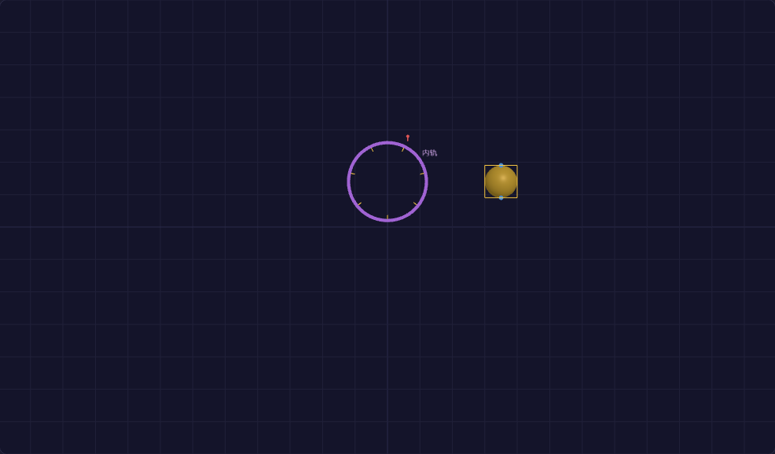

# PhysiScene · AI Agent 智能物理实验平台

面向高中物理（人教版 2019）的仿真实验平台：**120 张实验卡**（教材 55 + 高考 65）+
自由搭建台 + AI 助教/解题讲解。三端架构：Vue3 前端（three.js 渲染）+ Java 后端
（dyn4j 刚体物理/电路 MNA）+ Python AI 服务（DeepSeek + 教材知识库 RAG）。



## 功能

- **实验库**（/exp）：120 卡——教材实验（步骤+AI 助教按问法分流）与高考多过程题
  （九段解题模板 + 🤖 AI 深讲成文推导）
- **自由搭建**（/lab）：85 种元件拖拽/连线/设参，多引擎路由（刚体/电磁场/电路 MNA/
  热学/光学/近代/天体/交变），云端保存/深链/回放时间轴
- **AI**：意图分流问答（问答案→答案+推理；求方法→分步；验证→纠错）、场景识别诊断
  （"我搭的对吗"）、OCR 拍照识题、教材出处引用（Chroma RAG）

## 依赖

Node ≥24 + pnpm 11 · Java 17 + Maven · MySQL 8 · Python 3.12（poetry）· DeepSeek API key

## 运行

详见 [docs/deployment.md](docs/deployment.md)（从零安装/配置/冒烟/排查）。速览：

```bash
mysql -e "CREATE DATABASE physicene"                 # ① 建库（Flyway 自动迁移）
cd java-backend && mvn package -DskipTests && java -jar target/*.jar   # ② 后端 8080
cd ../python-ai-service && poetry install && .venv/Scripts/python -m uvicorn physicene_ai.main:app --port 8000  # ③ AI（配 .env）
cd ../frontend && pnpm install && pnpm dev           # ④ 前端 5173
```

## AI 配置（BYOK——自带 DeepSeek key，费用由部署者承担）

1. 到 https://platform.deepseek.com/ 注册并充值，创建 API key（形如 `sk-xxx`）
2. 复制模板：`cp python-ai-service/.env.example python-ai-service/.env`，填入
   `DEEPSEEK_API_KEY=sk-xxx`，重启 AI 服务（`.env` 已被 .gitignore 排除，不会入库）
3. **不配 key 也能跑**：仿真/实验/内置讲解/解题模板/回放全部可用；点 AI 问答会得到
   显式提示"请先配置 DeepSeek API key"，不是静默失败
4. 费用参考：约 1.5-2.2k token/次问答；系统默认限流每学生 50 次/天 +
   全局并发 10（`AGENT_DAILY_QUOTA` / `AGENT_MAX_CONCURRENCY` 可调），超额有明确提示

### 前端构建失败（拉取 node:22-alpine 超时）

部分网络对 Docker Hub 限速，`node:22-alpine` 等基镜像可能拉不动。切国内 Docker 镜像源：

**Windows / Mac（Docker Desktop）**：Settings → Docker Engine → 编辑 JSON，加：
```json
{ "registry-mirrors": ["https://docker.1ms.run", "https://docker.mirrors.ustc.edu.cn"] }
```
→ Apply & Restart 后重试 `docker compose up -d --build`

**Linux**：编辑 `/etc/docker/daemon.json` 加同样的 `registry-mirrors` → `sudo systemctl restart docker`

仍拉不动时的兜底（宿主有 Node ≥22）：`cd frontend && pnpm install && pnpm build` 产出
dist/ 后，用 runtime 目标构建前端镜像——见 docs/Docker-FAQ.md「前端镜像 runtime 兜底」。

### 常见问题（Clone 验证实测补充 · 2026-10-12）

- **改了 Java 端口**：前端 Vite 开发代理固定指向 `localhost:8080`（vite.config.ts 的
  `/api` 与 `/ws`）——Java 换端口时同步改这两处 target
- **INTERNAL_KEY 开箱即用**：未配置时 Java 与 Python 用同一默认内部密钥，本地开发
  直接可用；生产请在两侧配同名强密钥（环境变量 / .env）
- 完整排查表（端口占用/DB 连接/AI 不可用）见 docs/deployment.md §0.4

## 目录

```
frontend/     Vue3 + three.js（搭建台/实验框架/TS 物理引擎/85+ E2E 脚本）
java-backend/ Spring Boot + dyn4j（物理/场景/回放/WS）
python-ai-service/ FastAPI（DeepSeek agent/OCR/RAG 知识库）
docs/         交付文档（部署/监控/安全/回滚/各阶段报告）
```

## 测试

```bash
cd frontend && npx vitest run          # 373 单测
cd java-backend && mvn test            # 117 单测
cd frontend && python e2e/builder-check.py   # 69 模板 E2E（全套清单见 docs）
```

## License

MIT（教材 PDF 等版权资料不入库，见 .gitignore）
